  

  <a href="https://sanctuary-ds.github.io/playground/">Playground</a> ·
  <a href="https://sanctuary-ds.github.io/docs/philosophy">Docs</a> ·
  <a href="https://github.com/sanctuary-ds/tokens">Tokens</a> ·
  <a href="https://github.com/sanctuary-ds/tokens/blob/main/docs/ecosystem.md">Ecosystem</a>
   
  

Sanctuary takes its language from a Gothic nave: stone that stays quiet, lead that draws the lines, and colored glass that does the precise work. It ships as design tokens first, so the same palette can theme a website, a component library, a terminal and a window manager.

- **Four flavors**, the hours of the day: Lauds, Vespers, Compline and Matins.
- **Twelve pigments** as accents, each re-toned per flavor to stay legible.
- **Three glazings** for how the accent sits on a surface: pot-metal, flashed and grisaille.
- **OKLCH** color and **DTCG** tokens, with contrast pairings that are tested, not assumed.

The [ecosystem map](https://github.com/sanctuary-ds/tokens/blob/main/docs/ecosystem.md) tracks which repositories exist and what comes next.

Created and maintained by <a href="https://anthonyportugal.github.io">Anthony Portugal</a>.

